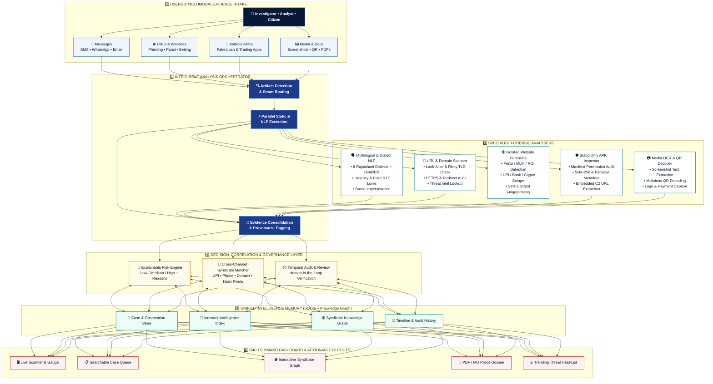

# 🛡️ THADAM — The Intelligent Cyber-Fraud Investigation Companion

**Problem Statement:** PS01 · Cyber Fraud / Phishing / Malicious Apps  
**Title:** Scam Message & Phishing Link Detection with Fake Loan / Investment App and Fraudulent Website Analysis[cite: 8]  
**Event:** Rajasthan Police Cyber Security Hackathon 2026 (R4C)[cite: 8, 9]  
**Team:** DYNAMITE[cite: 8]

---

## 📋 Problem Statement

Citizens routinely receive fraudulent KYC, parcel, electricity-bill, and job messages containing malicious links. Simultaneously, fake instant-loan and investment Android apps misuse sensitive user permissions, while Ponzi, MLM, and illegal betting websites lure victims with unrealistic guaranteed returns[cite: 1]. Although these fraud operations frequently reuse the same domains, app identifiers, phone numbers, and UPI/bank/crypto payment accounts across channels, they are reported and investigated in isolation[cite: 1].

**Objective:** Build a unified cyber-fraud investigation platform that ingests suspicious messages, URLs, Android APKs/app-store links, and websites; analyzes their content and technical indicators; extracts actionable identifiers; links cross-channel fraud campaigns with explainable **Low / Medium / High** risk verdicts; and maintains searchable case records, heat-lists, and downloadable evidence reports for police investigation[cite: 1].

---

## 💡 Our Solution — THADAM

**THADAM** (_The Intelligent Cyber-Fraud Investigation Companion_) is an AI-powered, multilingual digital forensics and cyber-fraud attribution platform built for R4C investigators and citizens[cite: 9].

### What Makes THADAM Different

- **Unified Multi-Artifact Intake:** Analyzes SMS/WhatsApp/email text, phishing URLs, fraudulent Ponzi/betting websites, Android APKs, and screenshots/QR codes in a single workspace[cite: 9, 10].
- **Dialect-Aware Multilingual Intelligence:** Detects scam intent, urgency lures, and brand impersonation across English, Hindi, and 6 regional Rajasthani dialects (_Marwari, Mewari, Dhundhari, Hadoti, Mewati, Bagri_)[cite: 9, 12].
- **Static-Only APK & Website Forensics:** Safely inspects `AndroidManifest.xml` permissions (`READ_SMS`, `RECEIVE_SMS`, `SYSTEM_ALERT_WINDOW`), `.dex` bytecode URLs, and website payment trails without risky sandbox execution[cite: 10, 11].
- **Automated Identifier Extraction & Cross-Channel Linking:** Automatically extracts UPI VPAs, `+91` phone numbers, domains, crypto wallets, and SHA-256 hashes, then correlates separate cases sharing identical infrastructure into syndicate clusters[cite: 9, 10].
- **Explainable Risk Scoring & Dossier Generation:** Assigns transparent **Low / Medium / High** risk tiers backed by exact triggered signals and generates investigation-ready PDF/Markdown dossiers[cite: 9, 10].

---

## 🏗️ System Architecture

